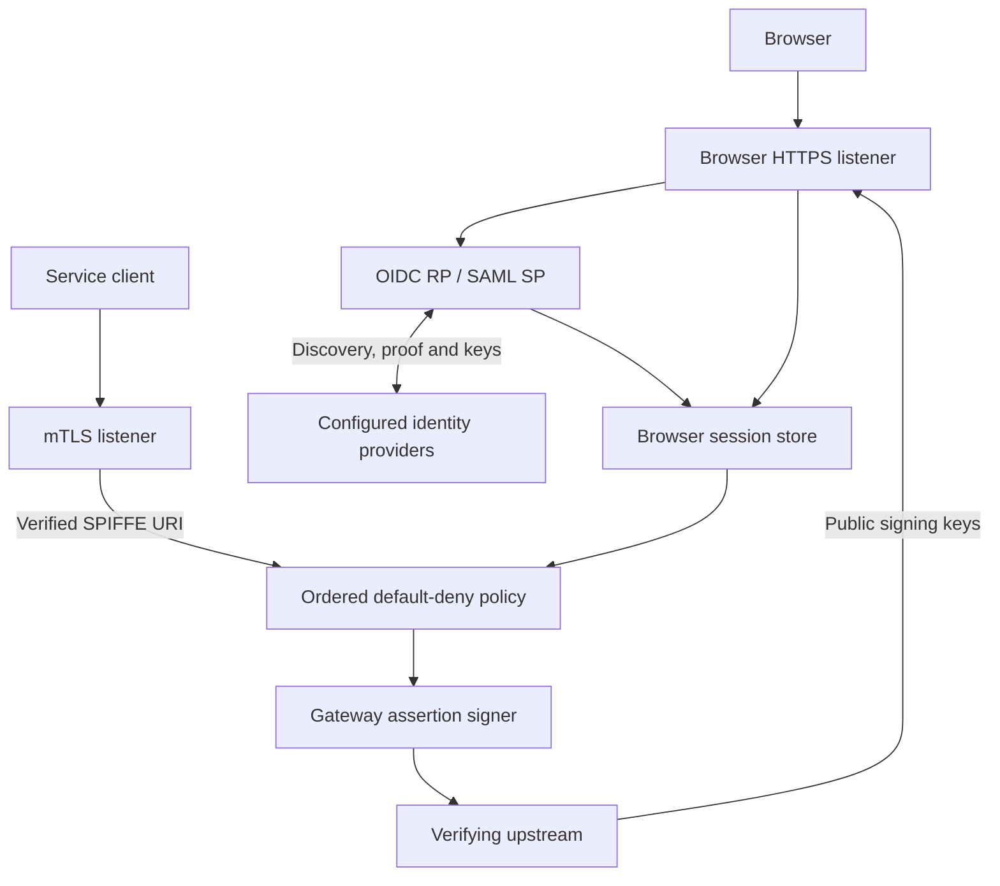
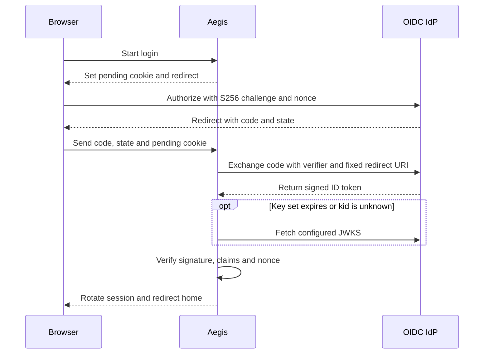
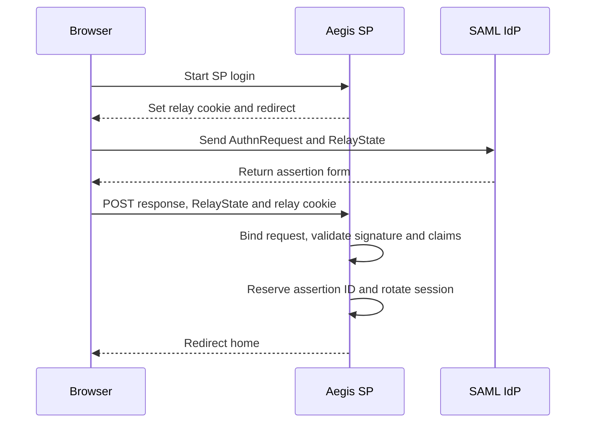
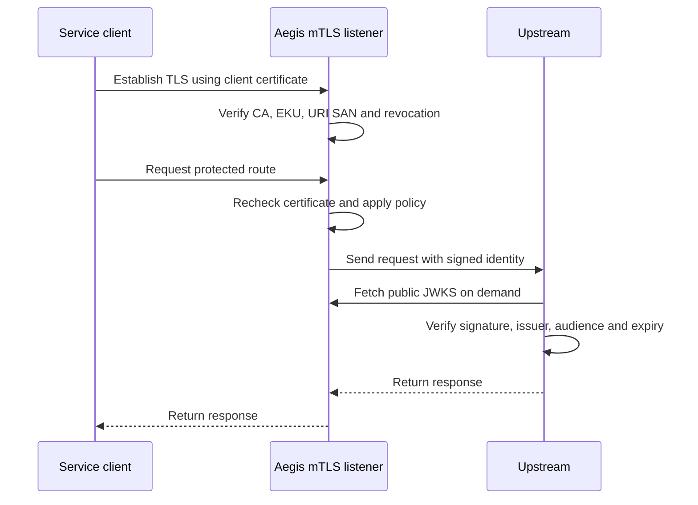

# Architecture

`cmd/aegis` composes the production listeners, policy and provider configuration. `cmd/demo` runs the same protocol handlers with in-process identity providers and a separate verifying upstream HTTP listener. Human and machine traffic share policy and assertion signing.

## OIDC login

## SAML login

The relay cookie is available to a cross-site POST. The longer-lived browser session uses SameSite=Lax. Aegis remembers the old session ID with the pending SAML request so it can retire that session even when the ACS request omits the old cookie.

## Machine request

The application does not trust ingress-supplied identities. Trusted proxy CIDRs only affect the forwarded address chain. Attached headers and cookies cannot establish a machine or human identity. The public JWKS contains only the assertion key's public portion.
